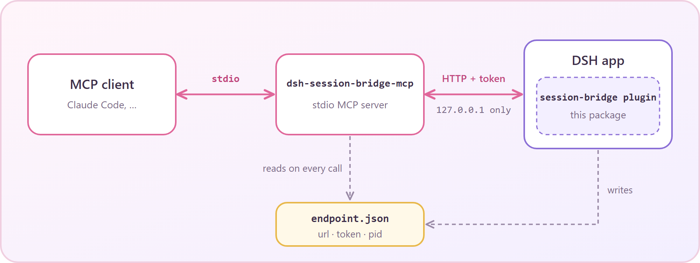

<div align="center">

# ♡ dsh-session-bridge ♡

**Let your MCP client talk to DeepSeek Harness sessions~**

English · [简体中文](README.zh-CN.md) · [繁體中文](README.zh-TW.md)

`@stellarie/dsh-session-bridge` (≧∀≦)

</div>

> Unofficial. This project has no tie to DeepSeek. It targets DeepSeek Harness `0.2.1-rc.2`.

## What is this?

DeepSeek Harness (DSH) is a desktop agent app. This package lets another agent drive it.

You get two small parts:

- **A host plugin.** It runs inside the DSH app. It serves a token-guarded loopback HTTP bridge.
- **A stdio MCP server.** Your MCP client (Claude Code, for example) starts it. It talks to the bridge.

Your client opens a normal DSH session, sends it messages, waits for the reply, and reads it.
The session shows in the app like any other session. You can watch it, or take it over, any time ♡

<p align="center"></p>

## Requirements

- DeepSeek Harness `0.2.1-rc.2`, with a profile you can edit.
- Node.js `^22.19.0` or `>=24.0.0`.
- An MCP client that speaks stdio.

## Install

### 1. Install the plugin

Use the `dsh` CLI. Replace `default` with the name of your profile.

```bash
dsh plugin --profile default add @stellarie/dsh-session-bridge
```

Or install straight from GitHub. The install builds the package on your machine, so the profile must allow build scripts:

```bash
dsh plugin --profile default add github:stellarie/dsh-session-bridge
```

Or edit the profile by hand. Add the package to the profile `package.json`. Then list it in the bundles, after `@deepseek-ai/dsh-web-app`.

```jsonc
{
  "dependencies": {
    "@stellarie/dsh-session-bridge": "^0.1.0"
  },
  "dsh": {
    "profile": {
      "bundles": [
        "@deepseek-ai/dsh-base",
        "@deepseek-ai/dsh-web-app",
        "@stellarie/dsh-session-bridge"
      ]
    }
  }
}
```

The package ships a `cordis.patch.yml`. It inserts the plugin row for you. Restart the app.
The log shows `session-bridge: serving http://127.0.0.1:…/session-bridge`.

### 2. Register the MCP server

Point your MCP client at the copy inside the profile (`<profile-dir>` is your DSH profile directory):

```bash
claude mcp add dsh-session-bridge -- node <profile-dir>/node_modules/@stellarie/dsh-session-bridge/lib/mcp.js
```

Or run it from npm, with no profile install:

```bash
claude mcp add dsh-session-bridge -- npx -y -p @stellarie/dsh-session-bridge dsh-session-bridge-mcp
```

Any other MCP client works too. The command is `dsh-session-bridge-mcp`. The transport is stdio.

The MCP server reads the endpoint file on every call. An app restart needs no MCP restart.

## Tools

| Tool | What it does |
|---|---|
| `dsh_list_sessions` | List sessions: id, title, preset, working directory, running or idle. |
| `dsh_open_session` | Open a session in `cwd`. Reuses the newest idle session with the same `preset` and `cwd`. Pass `reuse: false` for a new one. |
| `dsh_send` | Send a message. Mode `queue` runs after the current turn. Mode `steer` joins the running turn. Returns `afterSeq`. |
| `dsh_wait` | Wait until the session ends a turn after `afterSeq`. Default 600 s, maximum 600 s. |
| `dsh_read` | Read your prompts and the assistant text after `afterSeq`. Tool calls and thinking are left out. |
| `dsh_cancel` | Interrupt the running turn. Queued messages stay queued. |

A typical round trip:

```text
dsh_open_session { cwd: "C:/repo", preset: "my-preset" }  → { sessionId, reused }
dsh_send         { sessionId, text: "Fix the failing test" } → { accepted, afterSeq: 41 }
dsh_wait         { sessionId, afterSeq: 41 }               → { ended: true, lastSeq: 58 }
dsh_read         { sessionId, afterSeq: 41 }               → { messages: [ … ] }
```

> `dsh_open_session` defaults `preset` to `yuu`, the author's own preset. Pass your own preset id.
> See [BACKLOG 1](docs/BACKLOG.md).

## How the bridge stays safe (｀ω´)ゞ

The bridge gives full owner control of your sessions. Read this part, please.

Every request must pass these checks, in this order:

1. No `Origin` header. Browser pages always send one, so they are refused.
2. A loopback `Host` (`127.0.0.1`, `localhost`, or `[::1]`) with the server port.
3. A bearer token, compared in constant time.
4. `POST` only, with a JSON body of at most 1 MiB.
5. A method on the allowlist: `create`, `prompt`, `page`, `projections`, `list`, `cancel`.

The token is 32 random bytes. The plugin mints a new one at each start.
It writes `endpoint.json` (`url`, `token`, `pid`, `startedAt`) with mode `0600` (POSIX) and deletes it on shutdown.

- **Treat the endpoint file as a secret.** Anyone who reads it can prompt your agents.
- The bridge listens only where the DSH web server listens. It adds no port of its own.
- The bridge speaks as the app owner. A prompt you send acts like a prompt you type in the app.

## Configuration

| Setting | Where | Default |
|---|---|---|
| `endpointPath` | plugin config in `cordis.patch.yml` | `$DSH_HOME/session-bridge/endpoint.json` |
| `DSH_SESSION_BRIDGE_ENDPOINT` | environment of the MCP server | unset |
| `DSH_HOME` | environment | `~/.dsh` |

Set the same path on both sides when you move the file.

## Develop

```bash
pnpm install
pnpm run typecheck
pnpm test
pnpm run build
```

The build writes `lib/index.js` (the plugin) and `lib/mcp.js` (the MCP server).

## License

MIT © stellarie. Made with ♡ (๑˃ᴗ˂)ﻭ
