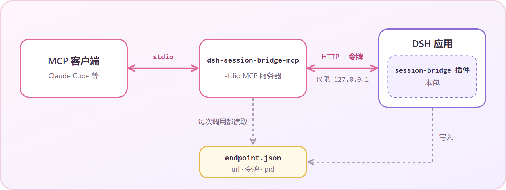

<div align="center">

# ♡ dsh-session-bridge ♡

**让你的 MCP 客户端和 DeepSeek Harness 会话聊天~**

[English](README.md) · 简体中文 · [繁體中文](README.zh-TW.md)

`@stellarie/dsh-session-bridge` (≧∀≦)

</div>

> 非官方项目，与 DeepSeek 无关。目标版本：DeepSeek Harness `0.2.1-rc.2`。

## 这是什么？

DeepSeek Harness（DSH）是一款桌面智能体应用。这个包让另一个智能体来驾驶它。

它由两个小部件组成：

- **宿主插件。** 运行在 DSH 应用内部，提供一个带令牌保护的本机回环 HTTP 桥。
- **stdio MCP 服务器。** 由你的 MCP 客户端（例如 Claude Code）启动，负责和桥通信。

客户端可以打开一个普通的 DSH 会话、发送消息、等待回复并读取它。
这个会话和其他会话一样显示在应用里。你随时可以旁观，也可以接手 ♡

<p align="center"></p>

## 环境要求

- DeepSeek Harness `0.2.1-rc.2`，并且你可以编辑它的配置档（profile）。
- Node.js `^22.19.0` 或 `>=24.0.0`。
- 一个支持 stdio 的 MCP 客户端。

## 安装

### 1. 把插件加入 DSH profile

在 profile 的 `package.json` 里加入依赖，然后把它写进 bundles，位置在 `@deepseek-ai/dsh-web-app` 之后。

```jsonc
{
  "dependencies": {
    "@stellarie/dsh-session-bridge": "^0.1.0"
  },
  "dsh": {
    "profile": {
      "bundles": [
        "@deepseek-ai/dsh-base",
        "@deepseek-ai/dsh-web-app",
        "@stellarie/dsh-session-bridge"
      ]
    }
  }
}
```

包内附带 `cordis.patch.yml`，它会替你插入插件条目。重启应用。
日志会显示 `session-bridge: serving http://127.0.0.1:…/session-bridge`。

### 2. 注册 MCP 服务器

```bash
claude mcp add dsh-session-bridge -- npx -y -p @stellarie/dsh-session-bridge dsh-session-bridge-mcp
```

其他 MCP 客户端也可以使用。命令是 `dsh-session-bridge-mcp`，传输方式是 stdio。

MCP 服务器每次调用都会重新读取 endpoint 文件，所以重启应用后不需要重启 MCP。

## 工具

| 工具 | 作用 |
|---|---|
| `dsh_list_sessions` | 列出会话：id、标题、预设、工作目录、是否正在运行。 |
| `dsh_open_session` | 在 `cwd` 中打开会话。默认复用 `preset` 和 `cwd` 相同的最新空闲会话。传 `reuse: false` 则新建。 |
| `dsh_send` | 发送消息。`queue` 模式在当前回合结束后运行，`steer` 模式加入正在运行的回合。返回 `afterSeq`。 |
| `dsh_wait` | 等待会话在 `afterSeq` 之后结束一个回合。默认 600 秒，最长 600 秒。 |
| `dsh_read` | 读取 `afterSeq` 之后你的提示和助手的文本。不含工具调用和思考内容。 |
| `dsh_cancel` | 中断正在运行的回合。已排队的消息继续保留。 |

一次典型的往返：

```text
dsh_open_session { cwd: "C:/repo", preset: "my-preset" }  → { sessionId, reused }
dsh_send         { sessionId, text: "Fix the failing test" } → { accepted, afterSeq: 41 }
dsh_wait         { sessionId, afterSeq: 41 }               → { ended: true, lastSeq: 58 }
dsh_read         { sessionId, afterSeq: 41 }               → { messages: [ … ] }
```

> `dsh_open_session` 的 `preset` 默认值是 `yuu`，那是作者自己的预设。请传入你自己的预设 id。
> 参见 [BACKLOG 1](docs/BACKLOG.md)。

## 桥如何保证安全 (｀ω´)ゞ

这座桥拥有对你会话的完整所有者控制权。请务必读完这一节。

每个请求都必须按顺序通过这些检查：

1. 没有 `Origin` 头。浏览器页面一定会带上它，所以会被拒绝。
2. `Host` 是回环地址（`127.0.0.1`、`localhost` 或 `[::1]`），且端口与服务器端口一致。
3. 带有持有者令牌（bearer token），并以恒定时间比较。
4. 只允许 `POST`，JSON 正文最大 1 MiB。
5. 方法在白名单内：`create`、`prompt`、`page`、`projections`、`list`、`cancel`。

令牌是 32 个随机字节，插件每次启动都会重新生成。
插件在 POSIX 上以 `0600` 权限写入 `endpoint.json`（`url`、`token`、`pid`、`startedAt`），关闭时删除。

- **请把 endpoint 文件当作机密。** 任何能读取它的人都可以向你的智能体发送提示。
- 桥只监听 DSH 网页服务器所监听的地址，不会自己再开端口。
- 桥以应用所有者的身份发言。你发送的提示，效果等同于你在应用里亲手输入的提示。

## 配置

| 设置 | 位置 | 默认值 |
|---|---|---|
| `endpointPath` | `cordis.patch.yml` 中的插件配置 | `$DSH_HOME/session-bridge/endpoint.json` |
| `DSH_SESSION_BRIDGE_ENDPOINT` | MCP 服务器的环境变量 | 未设置 |
| `DSH_HOME` | 环境变量 | `~/.dsh` |

移动文件时，请在两侧设置相同的路径。

## 开发

```bash
pnpm install
pnpm run typecheck
pnpm test
pnpm run build
```

构建会生成 `lib/index.js`（插件）和 `lib/mcp.js`（MCP 服务器）。

## 许可证

MIT © stellarie。用 ♡ 制作 (๑˃ᴗ˂)ﻭ
