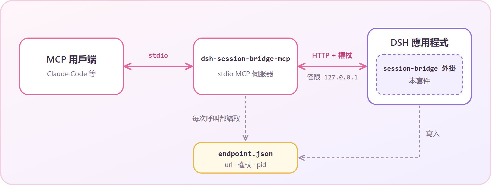

<div align="center">

# ♡ dsh-session-bridge ♡

**讓你的 MCP 用戶端和 DeepSeek Harness 工作階段聊天~**

[English](README.md) · [简体中文](README.zh-CN.md) · 繁體中文

`@stellarie/dsh-session-bridge` (≧∀≦)

</div>

> 非官方專案，與 DeepSeek 無關。目標版本：DeepSeek Harness `0.2.1-rc.2`。

## 這是什麼？

DeepSeek Harness（DSH）是一款桌面智慧代理應用程式。這個套件讓另一個代理來駕駛它。

它由兩個小元件組成：

- **主機外掛。** 執行在 DSH 應用程式內部，提供一個有權杖保護的本機迴環 HTTP 橋。
- **stdio MCP 伺服器。** 由你的 MCP 用戶端（例如 Claude Code）啟動，負責和橋通訊。

用戶端可以開啟一個一般的 DSH 工作階段、傳送訊息、等待回覆並讀取它。
這個工作階段和其他工作階段一樣顯示在應用程式裡。你隨時可以旁觀，也可以接手 ♡

<p align="center"></p>

## 環境需求

- DeepSeek Harness `0.2.1-rc.2`，而且你可以編輯它的設定檔（profile）。
- Node.js `^22.19.0` 或 `>=24.0.0`。
- 一個支援 stdio 的 MCP 用戶端。

## 安裝

### 1. 安裝外掛

使用 `dsh` 命令列。請把 `default` 換成你的 profile 名稱。

```bash
dsh plugin --profile default add @stellarie/dsh-session-bridge
```

也可以直接從 GitHub 安裝。安裝時會在你的機器上建置本套件，所以 profile 必須允許執行建置指令碼：

```bash
dsh plugin --profile default add github:stellarie/dsh-session-bridge
```

也可以手動編輯 profile。在 profile 的 `package.json` 裡加入相依套件，然後把它寫進 bundles，位置在 `@deepseek-ai/dsh-web-app` 之後。

```jsonc
{
  "dependencies": {
    "@stellarie/dsh-session-bridge": "^0.1.0"
  },
  "dsh": {
    "profile": {
      "bundles": [
        "@deepseek-ai/dsh-base",
        "@deepseek-ai/dsh-web-app",
        "@stellarie/dsh-session-bridge"
      ]
    }
  }
}
```

套件內附 `cordis.patch.yml`，它會替你插入外掛項目。重新啟動應用程式。
記錄會顯示 `session-bridge: serving http://127.0.0.1:…/session-bridge`。

### 2. 註冊 MCP 伺服器

讓 MCP 用戶端指向 profile 內的副本（`<profile-dir>` 是你的 DSH profile 目錄）：

```bash
claude mcp add dsh-session-bridge -- node <profile-dir>/node_modules/@stellarie/dsh-session-bridge/lib/mcp.js
```

或者直接從 npm 執行，不需要安裝到 profile：

```bash
claude mcp add dsh-session-bridge -- npx -y -p @stellarie/dsh-session-bridge dsh-session-bridge-mcp
```

其他 MCP 用戶端也可以使用。指令是 `dsh-session-bridge-mcp`，傳輸方式是 stdio。

MCP 伺服器每次呼叫都會重新讀取 endpoint 檔案，所以重新啟動應用程式後不需要重新啟動 MCP。

## 工具

| 工具 | 作用 |
|---|---|
| `dsh_list_sessions` | 列出工作階段：id、標題、預設組態、工作目錄、是否正在執行。 |
| `dsh_open_session` | 在 `cwd` 所在的工作區（Workspace）中開啟工作階段；工作區不存在時由應用程式建立。預設重用 `preset` 和 `cwd` 相同的最新閒置工作階段。傳入 `reuse: false` 則新建。新工作階段以 `effort`（預設 `high`）啟動。 |
| `dsh_send` | 傳送訊息。`queue` 模式在目前回合結束後執行，`steer` 模式加入正在執行的回合。回傳 `afterSeq`。 |
| `dsh_wait` | 等待工作階段在 `afterSeq` 之後結束一個回合。預設 600 秒，最長 600 秒。 |
| `dsh_read` | 讀取 `afterSeq` 之後你的提示和助理的文字。不含工具呼叫和思考內容。 |
| `dsh_cancel` | 中斷正在執行的回合。已排入佇列的訊息會保留。 |

一次典型的往返：

```text
dsh_open_session { cwd: "C:/repo", preset: "my-preset" }  → { sessionId, reused, workspaceId, effort }
dsh_send         { sessionId, text: "Fix the failing test" } → { accepted, afterSeq: 41 }
dsh_wait         { sessionId, afterSeq: 41 }               → { ended: true, lastSeq: 58 }
dsh_read         { sessionId, afterSeq: 41 }               → { messages: [ … ] }
```

> `dsh_open_session` 的 `preset` 預設值是 `yuu`，那是作者自己的預設組態。請傳入你自己的預設組態 id。
> 參見 [BACKLOG 1](docs/BACKLOG.md)。

> 新工作階段透過應用程式的模型選擇來設定 effort。應用程式同時會把這個 effort 儲存為所有工作階段的預設值。
> 參見 [BACKLOG 5](docs/BACKLOG.md)。

## 橋如何確保安全 (｀ω´)ゞ

這座橋擁有對你工作階段的完整擁有者控制權。請務必讀完這一節。

每個請求都必須依序通過這些檢查：

1. 沒有 `Origin` 標頭。瀏覽器頁面一定會帶上它，所以會被拒絕。
2. `Host` 是迴環位址（`127.0.0.1`、`localhost` 或 `[::1]`），且連接埠與伺服器連接埠一致。
3. 帶有持有人權杖（bearer token），並以固定時間比較。
4. 只允許 `POST`，JSON 內容最大 1 MiB。
5. 方法在允許清單內。工作階段方法：`create`、`prompt`、`page`、`projections`、`list`、`cancel`、`selectModel`、`modelCatalog`。工作區方法：`create`。

權杖是 32 個隨機位元組，外掛每次啟動都會重新產生。
外掛在 POSIX 上以 `0600` 權限寫入 `endpoint.json`（`url`、`token`、`pid`、`startedAt`），關閉時刪除。

- **請把 endpoint 檔案當作機密。** 任何能讀取它的人都可以向你的代理傳送提示。
- 橋只監聽 DSH 網頁伺服器所監聽的位址，不會自己再開連接埠。
- 橋以應用程式擁有者的身分發言。你傳送的提示，效果等同於你在應用程式裡親手輸入的提示。
- `dsh_open_session` 會在 `cwd` 沒有工作區時建立工作區，並把新工作階段的 effort 儲存為應用程式預設值。

## 設定

| 設定 | 位置 | 預設值 |
|---|---|---|
| `endpointPath` | `cordis.patch.yml` 中的外掛設定 | `$DSH_HOME/session-bridge/endpoint.json` |
| `DSH_SESSION_BRIDGE_ENDPOINT` | MCP 伺服器的環境變數 | 未設定 |
| `DSH_HOME` | 環境變數 | `~/.dsh` |

移動檔案時，請在兩側設定相同的路徑。

## 開發

```bash
pnpm install
pnpm run typecheck
pnpm test
pnpm run build
```

建置會產生 `lib/index.js`（外掛）和 `lib/mcp.js`（MCP 伺服器）。

## 授權

MIT © stellarie。用 ♡ 製作 (๑˃ᴗ˂)ﻭ
